# HTML Studio

A page per project, with a chat connected to a real coding agent. You say what you want; the
agent works in the project's folder with files, a shell, the web, skills and connectors, and
the page changes while it works. It starts from a blank page, or from an app you already have
on the same computer.

It runs on your own machine. It is a personal project at an early stage: read
[Safety](#safety) and [What it cannot do yet](#what-it-cannot-do-yet) before you rely on it.

[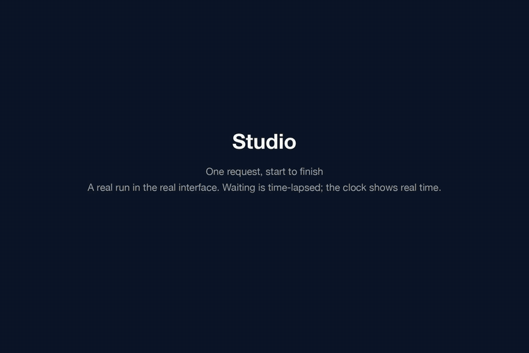](studio2/docs/demo/studio-demo.mp4)

*One real run, 95 seconds of video: 52 minutes of agent work as a time-lapse, then a change made
by selecting a heading and asking (34 seconds). The clock shows real time. Recorded 12 November
2026. [Full-size video](studio2/docs/demo/studio-demo.mp4) · [how it was recorded](studio2/tools/demo-video/README.md)*

## What you can do

Cut from real recordings of the real interface.

| | |
|---|---|
| **Ask, and watch it work**<br>[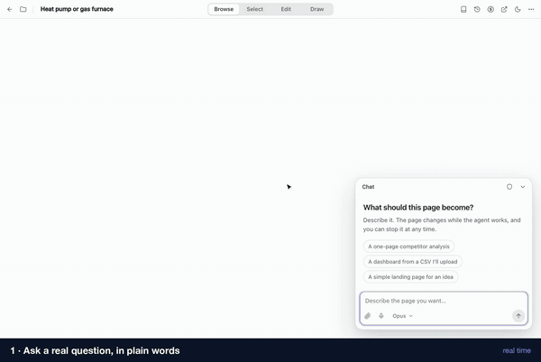](studio2/docs/demo/clips/ask-report.mp4)<br>Type a request; the page changes while the agent works. | **Edit text in place**<br>[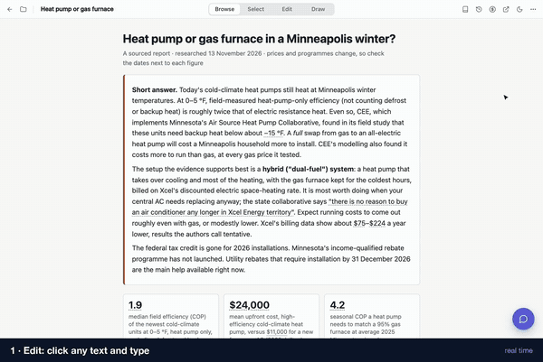](studio2/docs/demo/clips/edit-text.mp4)<br>Retype text on the page directly. |
| **Point at a part and ask**<br>[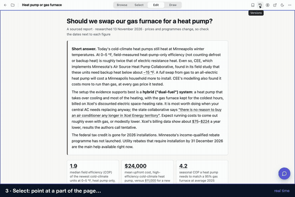](studio2/docs/demo/clips/select-ask.mp4)<br>Select one part and say what to change. | **Draw on the page**<br>[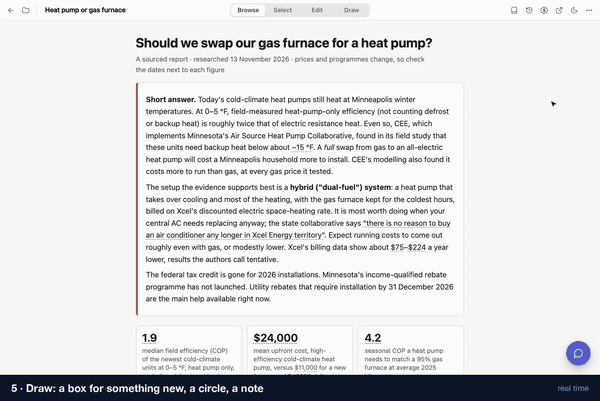](studio2/docs/demo/clips/draw.mp4)<br>Circle, box, note or drag things, then send the drawing. |
| **An app with its own back end**<br>[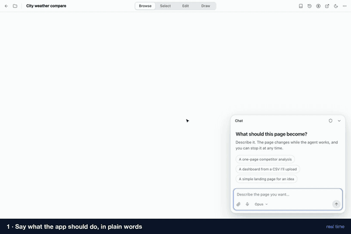](studio2/docs/demo/clips/app.mp4)<br>The studio starts the app's server and shows its log. | **Files and versions**<br>[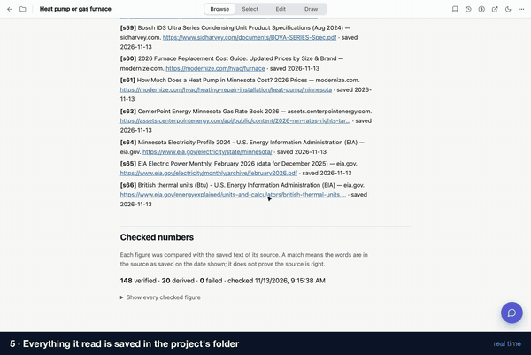](studio2/docs/demo/clips/versions-files.mp4)<br>Every request and edit is a version you can restore. |
| **Choose how much to do**<br>[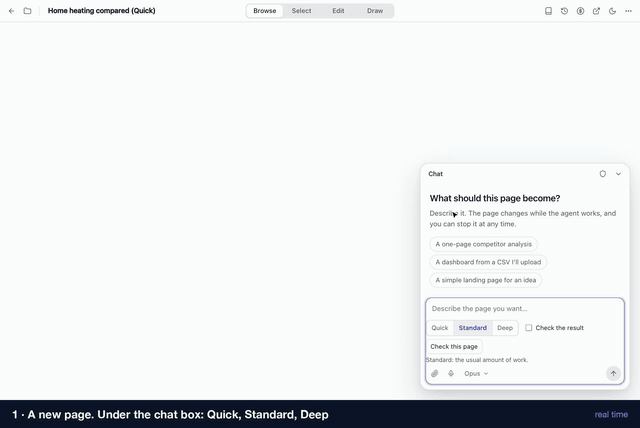](studio2/docs/demo/clips/depth.mp4)<br>Quick, Standard or Deep, set per request; this Quick one took 3 minutes 15 seconds. | **Check the page**<br>[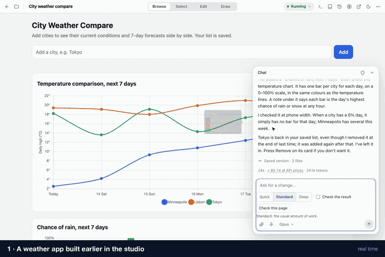](studio2/docs/demo/clips/check.mp4)<br>A separate checker goes over the page and reports counts and findings in a card. |

What it makes:

- **Sourced reports.** The agent saves every page or PDF it reads, and a check compares marked
  figures with the saved source.
- **Dashboards and data analysis** from files you drop in (CSV, Parquet, JSON) or your own
  PostgreSQL, Redshift or MySQL database, read-only.
- **Apps with their own back end**, served on the project's address. An app keeps what it writes
  while it runs in `state/`, which is not versioned and does not reload the page. A Python app's
  packages are pinned in a lock file, so it runs on the same versions every time. An app you stop
  stays stopped when the studio restarts.
- **PowerPoint, Word and Excel files** (needs LibreOffice). **Animation, 3D, pictures and video**
  rendered to MP4, GIF or WebM (needs `ffmpeg`).
- **Generated media** from Higgsfield. Every request shows its price and waits for your Allow.
- **Your own app.** Bring a folder from this computer as a safe copy or edit it in place, then
  send changes back with **Make it live** after an Allow on a card.

Each request shows what it cost and each page has a running total, kept apart as charged,
plan-equivalent and unpriced; a charged figure says whether the provider reported it or it was
calculated from a price list.

Detail: [what you can make, skills and connectors](studio2/docs/features.md) ·
[bringing an app and making it live](studio2/docs/apps.md).

## Examples

**Eight finished pages come with the studio.** The home page lists them (reports, dashboards, explainers
and a 3D scene, each with the model, the time it took and its sources); **Open a copy** makes one
yours to read, change or draw on. The saved text of their sources is not included (it is other
people's writing), so a check on a copy fetches each source again first.

Three more real runs, recorded on 13 November 2026 on Claude Opus, waiting shown as a time-lapse.
Click a picture for the full-size video, or watch
[all three as one video](studio2/docs/demo/demo-full.mp4) (4 minutes 48 seconds).

| A sourced report from one question | Change it by hand | An app from one request |
|---|---|---|
| [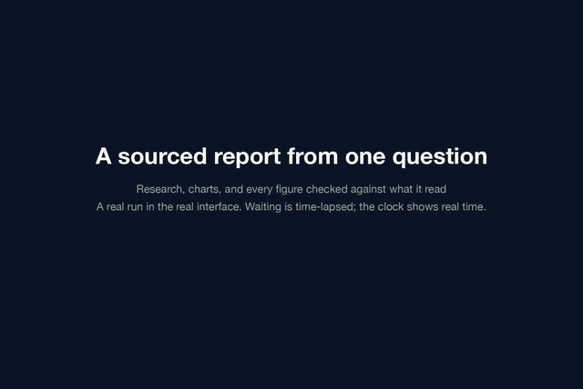](studio2/docs/demo/demo-report.mp4) | [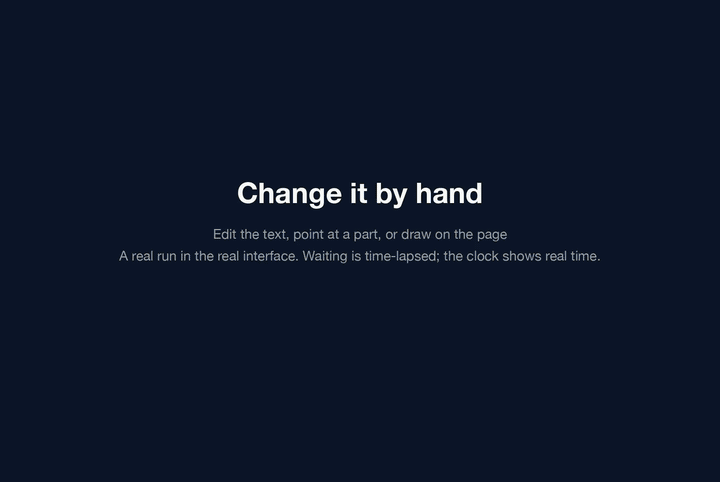](studio2/docs/demo/demo-edit-draw.mp4) | [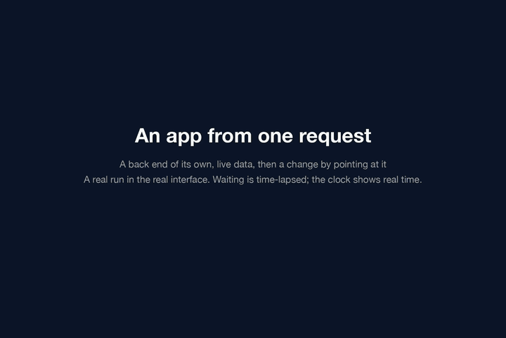](studio2/docs/demo/demo-app.mp4) |
| Heat pump or gas furnace in a Minneapolis winter. 21 minutes of work; 168 figures compared with their saved sources, none failed. | Retype the title, turn a checklist into tick boxes (37 s), draw a calculator (76 s). | A weather comparison on live Open-Meteo data that saves its cities (1 min 49 s). |

**Deep, with Check the result** (also 13 November):
[the run as a video](studio2/docs/demo/demo-deep-check.mp4) (80 seconds, [GIF](studio2/docs/demo/demo-deep-check.gif)).
The five-year cost of an electric car against a petrol car took 25 minutes 38 seconds: six
researchers in parallel, 126 sources saved, 58 cited. The check reported 387 items, 373 matched,
13 fixed, 1 not checkable; one reported fix (a missing source entry) was not on the final page.

A match means the words are in the saved source, not that the source is right. Full captions
and what the runs would have cost at API prices: [examples](studio2/docs/examples.md).

## Quick start

You need macOS or Linux (x86-64 or ARM64), `git`, `bash` and `curl` or `wget`. Windows is not
supported.

```sh
git clone https://github.com/ace26597/html-studio-public.git
./html-studio/studio2/install.sh
```

The installer fetches what is missing (`uv`, Python 3.12, Node 20 if needed), builds the
interface and writes a `studio` command into `~/.local/bin`. It does not use sudo and is safe to
run again. It asks up to four questions; `--yes` asks nothing.

On first run, `studio setup` asks three things (also asked on screen if you skip it):

1. **Which model account** (see below).
2. **Where it runs:** this computer only (the default), or also a private network address,
   port 8200 unless you change it.
3. **Who uses it:** just you, or shared. Shared switches the Claude plan off.

Then `studio start` prints the address, normally `http://127.0.0.1:8200/`, and opens the browser.
Press **New page** and type what you want. When something does not work, run `studio doctor`.

Tested on macOS only; the Linux paths are written but not run.
Full detail, every command and what was tested: [install and first run](studio2/docs/install.md).

## Model accounts

Claude models work best; other models are experimental.

| Account | What has actually been run |
|---|---|
| Your Claude plan, signed in on this computer | Almost every recorded run, on Opus, Sonnet and Haiku. Single-owner use only |
| An Anthropic API key | Environment tested; no paid request made |
| Claude on Amazon Bedrock, Google Vertex AI or Microsoft Foundry | Environment tested; no paid request made |
| A gateway you run that speaks Anthropic's format, such as LiteLLM | Whole requests on a GPT model |
| A key from OpenAI, OpenRouter, Azure OpenAI or Gemini | One GPT model through a stand-in gateway; no real key of these providers used |

Keys go in the system keychain (or a file only you can read, on a machine without one), never in
the config file. Full text, setup commands and what to
expect on non-Claude models: [model accounts](studio2/docs/models.md).

## Safety

- The agent runs commands as you, like a coding agent in a terminal. So does a project's back end.
- Risky shell commands ask first; file writes outside the project are refused. These rules read
  the command text. They catch ordinary mistakes; they are not a sandbox.
- Making an app live and buying generated media ask every time.
- **Never put it on a public address.** There are no user accounts and no isolation between
  projects yet, so whoever can open the studio can run commands on the machine.
- **One trusted person per machine.** An agent that set out to could answer its own approval card.
- A paid model account has no spending limit inside the studio; set one at the provider.

Full text: [safety and limits](studio2/docs/safety.md).

## What it cannot do yet

- Linux has not been run. Phones and tablets have not been tried on a real device.
- No accounts, isolation or hosting. It is for one person on their own machine.
- No request has been made with a real provider key, or on Bedrock, Vertex or Foundry.
- Only Next.js and Vite apps have been attached for real. No real app has been made live yet.
- A restart ends running requests.
- Redshift and MySQL are untested; MongoDB is not supported. Office files have not been opened in
  real PowerPoint, Word or Excel.

The full list is in [safety and limits](studio2/docs/safety.md). The
status table says, step by step, what was checked, how, and what
was not. It is the only record that is kept current.

## Where things are

| Path | What |
|---|---|
| [`studio2/`](studio2/) | The studio: server, interface, the library the agent is given, tests |
| [`studio2/docs/`](studio2/docs/) | The detail moved off this page: [install](studio2/docs/install.md), [models](studio2/docs/models.md), [features](studio2/docs/features.md), [apps](studio2/docs/apps.md), [safety](studio2/docs/safety.md), [examples](studio2/docs/examples.md) |
| [`studio2/README.md`](studio2/README.md) | For developers: layout, running from source, tests, every setting |
| [`studio2/ATTACH.md`](studio2/ATTACH.md) | Attaching an existing app and making it live, in detail |
| [`studio2/CONTRACT.md`](studio2/CONTRACT.md) | The API and event contract |
| `data/studio2/` | Your projects, one folder each with its own git history. Not in the repository; back it up yourself |

An earlier studio, a document engine, used to live in this repository beside this one. It was
removed from `main` on 13 November 2026 and is kept whole on the `legacy-engine` branch and the
`legacy-engine-2026-11-13` tag.

## Licence and status

MIT; see [LICENSE](LICENSE). This is a copy of a working repository, published for people to read and try. The plan, the step-by-step record of what was checked (called the status table in these pages) and the working notes are kept in the working repository and are not part of this copy.
