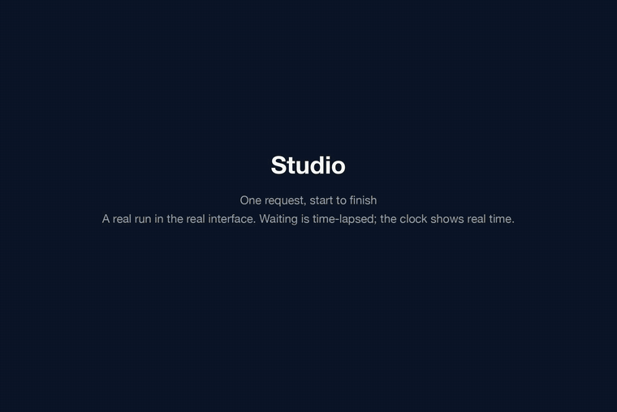
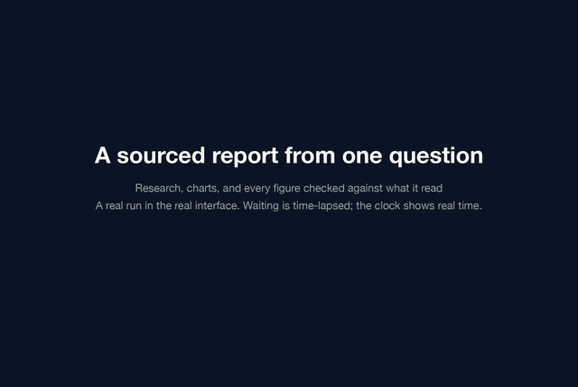
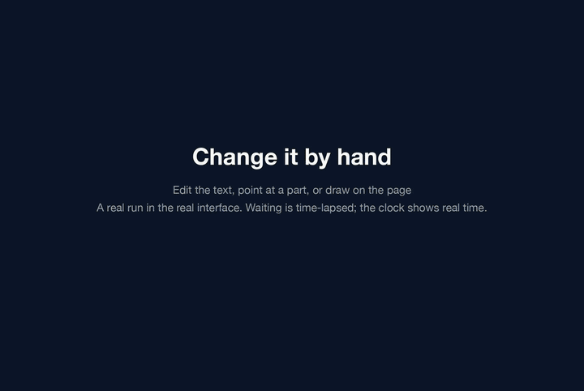
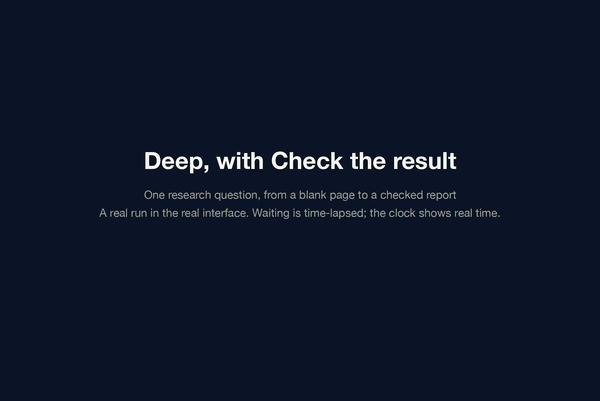
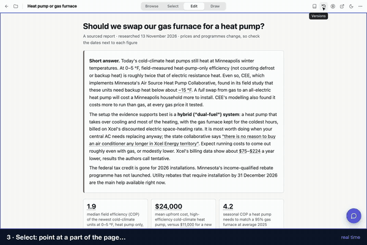
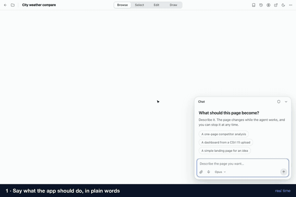
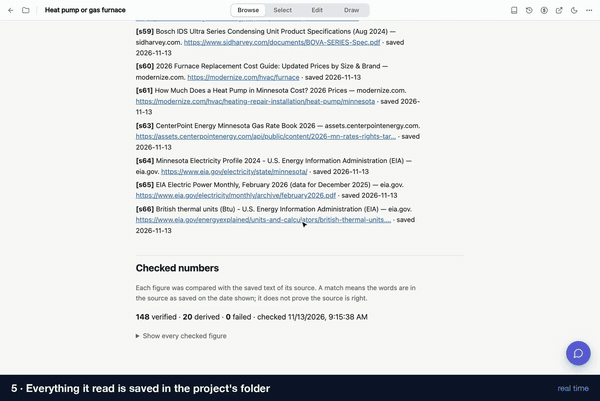
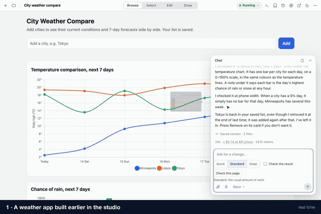

# Examples

Moved from the [front page](../../README.md). Pictures link to the full-size videos.

*One real run in the real interface, 95 seconds of video: 52 minutes of agent work shown as a
time-lapse, then a change made by selecting a heading and asking, which took 34 seconds. The
clock in the corner shows real time. Recorded 12 November 2026.
[Full-size video](demo/studio-demo.mp4) · [how it was recorded](../tools/demo-video/README.md)*

## More examples

Three more real runs, recorded on 13 November 2026 in the same way: the real interface, a real
agent on Claude Opus, waiting shown as a time-lapse with the real clock in the corner. Each picture
is a shortened GIF; the link under it is the full-size video.
[All three as one video, start to end](demo/demo-full.mp4) (4 minutes 48 seconds).

**A sourced report from one question.** "Should I replace a gas furnace with a heat pump in a
Minneapolis winter?"

*21 minutes of agent work in 81 seconds of video. The agent reported 66 documents saved and 39
cited; the page's own check lists 168 figures compared with their saved sources (148 quoted, 20
calculated from quoted ones), none failed. The report has a section on what it could not confirm.
A match means the words are in the saved source, not that the source is right.
[Full-size video](demo/demo-report.mp4)*

**Change it by hand.** On that report: retype the title in place, point at the checklist and ask
for tick boxes, then draw a box, a circle and a note on the page and send the drawing.

*The checklist took 37 seconds and the calculator, built from the drawing, 76 seconds. Every
change is a version. [Full-size video](demo/demo-edit-draw.mp4)*

**An app from one request.** A weather comparison with a back end of its own that saves the list
of cities, on live Open-Meteo data.

*The app took 1 minute 49 seconds and the second chart 24 seconds.
[Full-size video](demo/demo-app.mp4)*

These ran on a Claude plan, which is not billed per request. At API prices the agent program put
the report at about $10.60, the two changes to it at about $1.05 together, the app at about $0.50
and its second chart at about $0.14.

## Deep, with Check the result

**One research question at depth Deep, with the check switched on.** "How much does it cost to
own an electric car compared with a petrol car over five years in the US? Purchase price, fuel or
electricity, maintenance, insurance, incentives that exist today. Charts where numbers help."

*25 minutes 38 seconds of agent work in 80 seconds of video, recorded 13 November 2026 on Claude
Opus. The agent wrote a plan, then six researcher sub-agents ran in parallel for about six
minutes; 126 sources were saved and 58 are cited on the page, which has a section on what could
not be confirmed. A separate checker sub-agent then went over the page, and the agent reported the
check once: 387 items, 373 matched, 13 fixed, none left wrong, 1 could not be checked (a baseline
taken from a PDF table). Five figures picked by hand were in their saved sources. One reported fix,
a source missing from the list, is not on the final page: two citations (Kelley Blue Book and AAA)
still have no entry in the source list. The agent's own closing message says 11 problems were
fixed, the card 13. Two shell commands asked first: one, editing the page, was allowed; one that
also deleted files outside the project folder was denied, and the agent made its edit without it.
The waits on those two cards (about two minutes) are in the 25 minutes 38 seconds. The result card
and the walk through the page were filmed on a fresh load after the request ended. At API prices
the agent program put it at about $15.0.
[Full-size video](demo/demo-deep-check.mp4)*

**Quick** on a small request ("A one-page comparison of the three main ways to heat a home: gas
furnace, heat pump, electric baseboard. Short.") took 3 minutes 15 seconds: 35 tool calls, no
sub-agents, 5 sources saved, one table with 4 sourced figures, about $0.64 at API prices.
**Check this page** on the weather app took 5 minutes 26 seconds: one checker sub-agent, 343
checked, 337 matched, 6 fixed, among them both charts drawing Tokyo's days under the wrong dates.

## One feature at a time

Cut from the same recordings.

| | |
|---|---|
| **Ask, and watch it work**  | **Edit text in place**  |
| **Point at a part and ask**  | **Draw on the page**  |
| **An app with its own back end**  | **Files and versions**  |
| **Choose how much to do**  | **Check the page**  |
