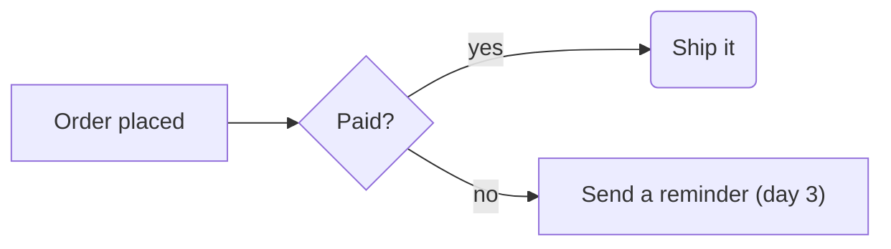
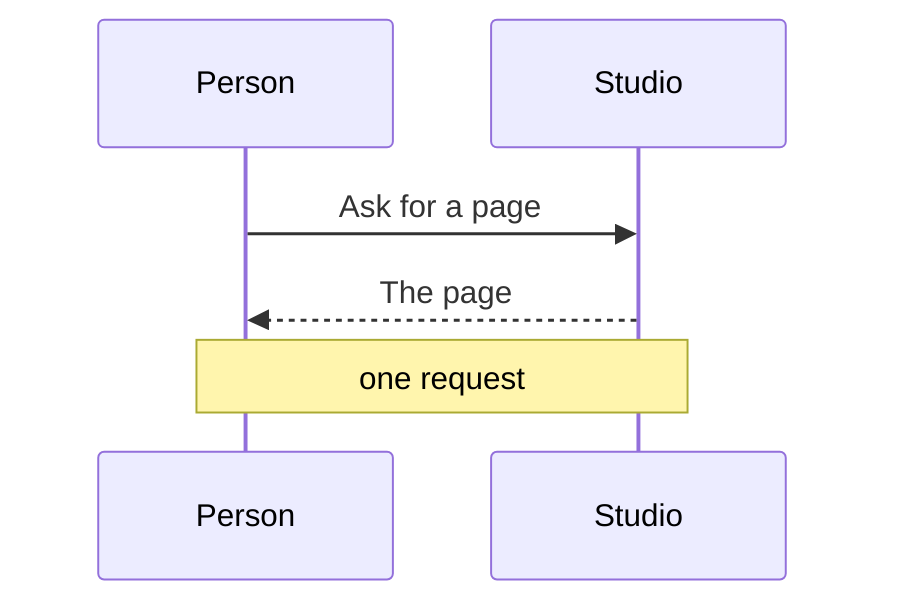
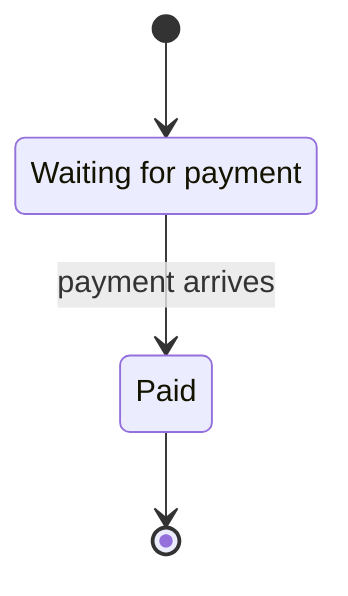
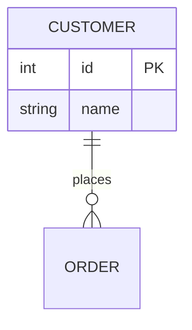
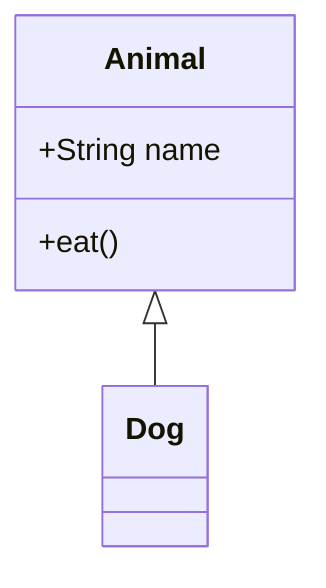
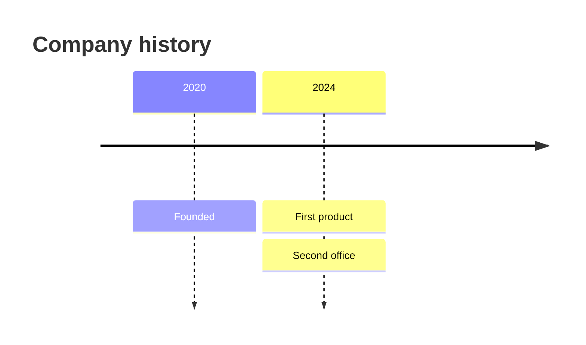
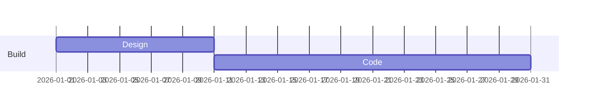

# Diagrams

## Does it need a diagram?
Draw one when the point is a **shape**: steps that branch or loop, who talks to whom in what
order, states and what moves between them, how tables relate, what happens when. Use a **table**
when the reader compares items on the same few attributes, and a **sentence** when it is a
straight line of three or four steps. A diagram nobody needs costs the reader more than it gives.

## Pick the type (Mermaid 11.15, the version the studio draws with)
| The job | Type (the first line) |
|---|---|
| Process, decision, flow | `flowchart LR` (or `TB`, top to bottom) |
| Who calls whom, in order | `sequenceDiagram` |
| States and what moves between them | `stateDiagram-v2` |
| Tables and how they link | `erDiagram` |
| Classes or types | `classDiagram` |
| What happened when | `timeline` |
| A project plan | `gantt` |

## What breaks it (or silently draws something else)
- **Brackets, parentheses, `#`, `;` or `:` inside a label.** `A[Total (est.)]` does not parse.
  Quote the label: `A["Total (est.)"]`. In a sequence message a `;` breaks the line and a `#`
  drops the rest of the text; write `#35;` and `#59;` for them.
- **Spaces in a name without quotes.** `[*] --> Waiting for payment` parses but draws three states;
  an unquoted ER label `: places order` draws two words apart. Use `state "Waiting for payment" as W`
  and `: "places order"`.
- **The word `end` in lower case** as a flowchart node breaks it; write `End` or `done`.
- **The first line must name the type** exactly (`flowchart`, `sequenceDiagram`, `stateDiagram-v2`,
  `erDiagram`, `classDiagram`, `timeline`, `gantt`). A Gantt task's dates must match `dateFormat`.

## The loop
1. Write the source. Keep it to what the reader needs: about 15 boxes at most; split a larger one.
2. Call `render_diagram` with a `name` (`order-flow`), the `source`, and `must_show`: the labels the
   diagram has to contain (every step, participant or table you meant to draw).
3. A parse error saves nothing and gives `line` and `error`: fix that line and call again. After
   three failed tries, use a simpler diagram or a table, and say so in your answer.
4. `missing` not empty: it parsed but is not what was asked (often a label with spaces or a `#`).
   Fix and call again. Without `must_show`, compare `nodes`, `edges` and `labels` with your intent.
5. `layout.hard_to_read` (wider than 1,400 px, or text under 9 px on a desktop page): split it, or
   change direction (`LR` to `TB`). `clipped_text` or `overlapping_text`: shorten those labels or
   break them with ` `. Render again.
6. `layout.small_on_phone` (text under 9 px on a phone): not an error, because a reader in the
   studio can press Enlarge on any diagram and zoom. When the person reads on a phone, or the
   page is a report they will pass on, prefer `flowchart TB` to `LR`, and no more than five
   participants across a sequence diagram.
7. Keep one `name` per diagram and render again under it; when you try another name and drop
   that variant, delete its files from `files/diagrams/` so nothing stale is left behind.

## Put it in the page
Use the saved SVG, never the Mermaid script. The answer's `embed` is a `<picture>` that shows
`<name>-dark.svg` when the reader's system is dark and `<name>.svg` otherwise; make its paths
relative to the page. When the page switches colours with its own control instead, put both SVGs
in and show one with the page's CSS (their ids differ, so both can sit inline). Give each a
caption that says what it shows, and an `alt` that says it in one sentence.

The studio puts an Enlarge button on a diagram, chart or image at least 160 by 100 px, and opens
it in a viewer to zoom and move around. Build nothing for that yourself, and do not wrap the
picture in a link or a button: the studio leaves pictures that already do something alone.

## Decks and Word files
Call again with `png_width` (1600 for a full slide, 1200 for a Word page, 800 for half a slide) and
put `files/diagrams/<name>.png` in the file with its own library, at that width or smaller. A PNG
is the light version on white. Render the deck or document afterwards and look at the page.

## How it looks is the person's choice
The studio's fixed setup (layout, font, look) keeps the picture the same between runs; it is not a
house style. When the page has its own palette, pass it in `colors` as Mermaid theme variables,
one set for each scheme: `{"light": {"primaryColor": "#fdf1e6", "primaryTextColor": "#3b2a14",
"primaryBorderColor": "#b8763a", "lineColor": "#8a4b08", "secondaryColor": "#eef4fb",
"tertiaryColor": "#f7f7f7"}, "dark": {…}}`. Use `classDef` and `class` in the source to pick out
one or two boxes, never to colour every one.

Never draw a chart of numbers with it (bars, lines, pies): that is the `charts` skill.
